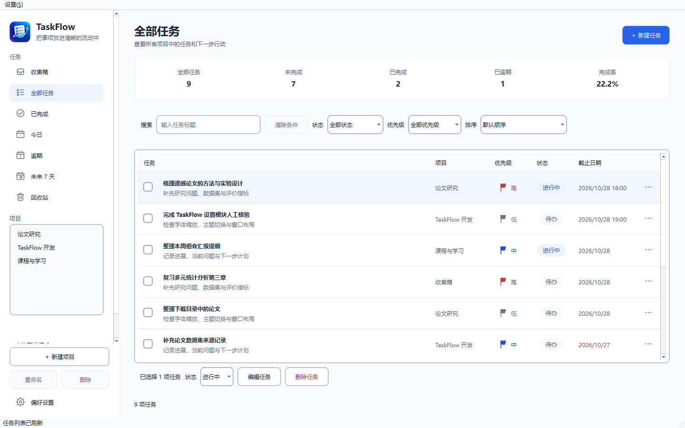
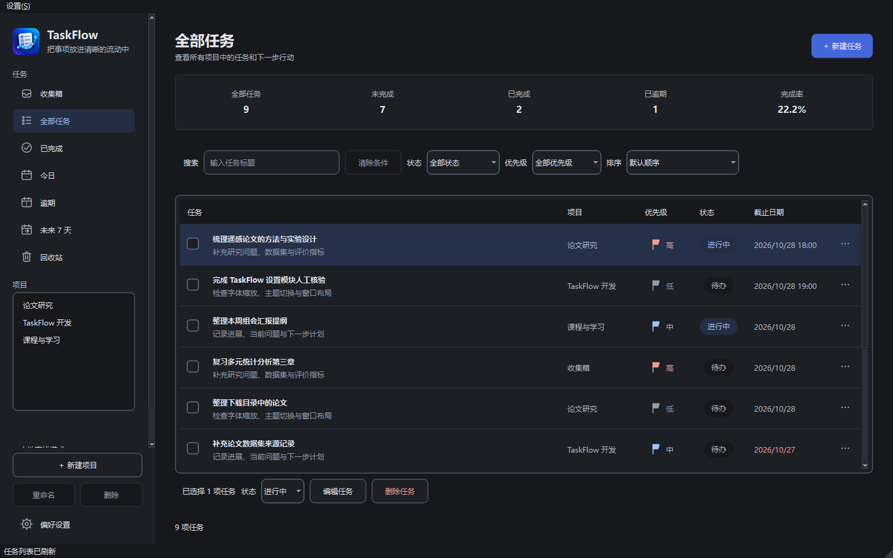

# TaskFlow 下载与反馈

TaskFlow 是 Windows 本地任务管理软件，支持项目分类、任务搜索筛选、日期视图、统计、回收站、到期提醒及主题/字体/语言设置。

## 下载与启动

**[下载 Windows x64 程序包](https://github.com/hqf2335/TaskFlow-Releases/releases/latest)**

在 Assets 中选择 `TaskFlow-0.1.0-windows-x64.zip`。完整解压后打开 `TaskFlow/TaskFlow.exe`，不需要安装 Qt；不要只复制 EXE。GitHub 自动生成的 Source code (zip/tar.gz) 是本下载仓库说明的快照，不能作为应用运行包。

面向 Windows 10/11 x64。本版为早期便携版本，未作应用代码签名；独立无 Qt 电脑、物理 DPI/多屏、托盘休眠和屏幕阅读器仍待全面人工验收。Windows 安全提示请结合官方来源和 SHA256 校验判断，无需关闭系统安全功能。

截图来自临时样例数据，不包含个人任务。

## 常用操作与数据

新建项目分类任务，Ctrl+F 搜索；今日、逾期、未来 7 天及回收站在左侧。偏好设置可选白色、深石墨、跟随系统及 9～24 pt 字号；语言保存后须完全退出重开。托盘可用时，关闭主窗口继续提醒，托盘“退出程序”完全退出。

数据通常保存在 `%APPDATA%\TaskFlow\TaskFlow\taskflow.sqlite3`，设置为同目录 `preferences.ini`。下载包不包含个人数据库；复制程序目录不会隔离同一 Windows 用户的数据。优先使用“数据 → 备份数据”，恢复前确认替换范围，重要操作前自行备份。

## 许可与第三方源码

TaskFlow 自有程序可按 [软件使用许可](LICENSE.txt) 免费使用，本仓库不公开其业务源码。Qt 等第三方组件保留各自许可与修改/替换权利，详见 [第三方声明](THIRD_PARTY_NOTICES.md) 和 [对应源码及库替换说明](SOURCE_CODE.md)。同一 Release 提供对应 Qt/GCC/MinGW 源码和构建材料，均可免费下载。

程序包包含运行依赖、使用说明、许可原文、清单及校验脚本。先核对 Release 的 SHA256SUMS.txt，再在解压目录运行 `powershell.exe -NoProfile -File .\Verify-Package.ps1`。校验仅检查完整性，不启动程序。

## 反馈

通过本仓库 Issues 提交问题，说明版本、Windows 环境、操作步骤和错误提示。请勿上传个人任务库、账号令牌或含敏感信息的截图。
